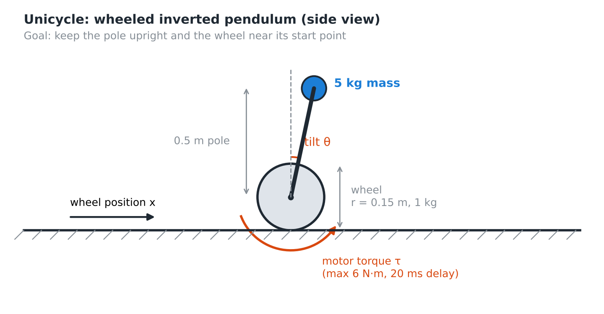
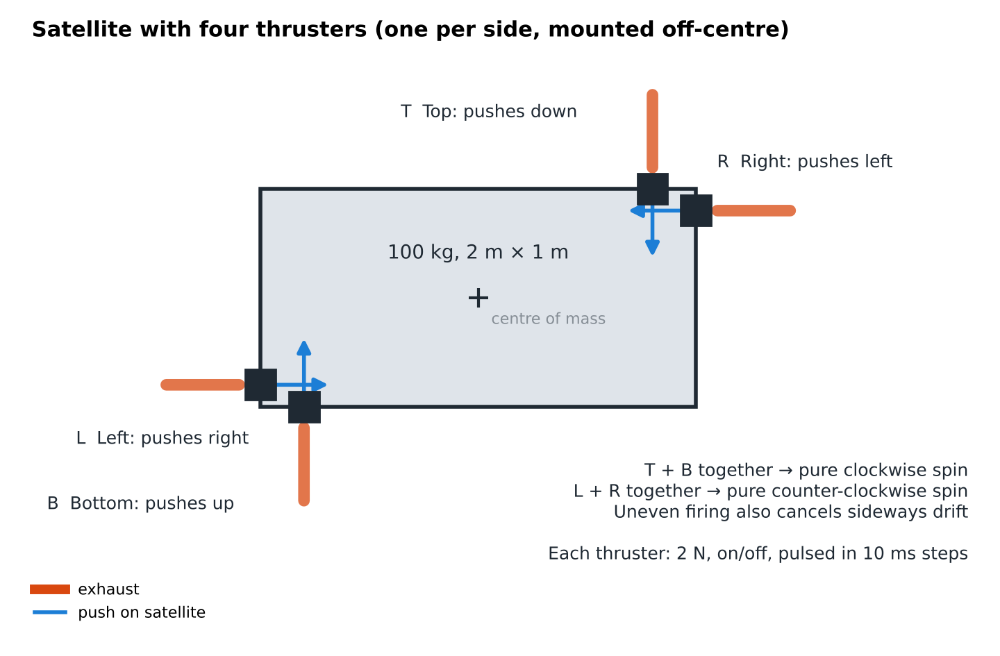
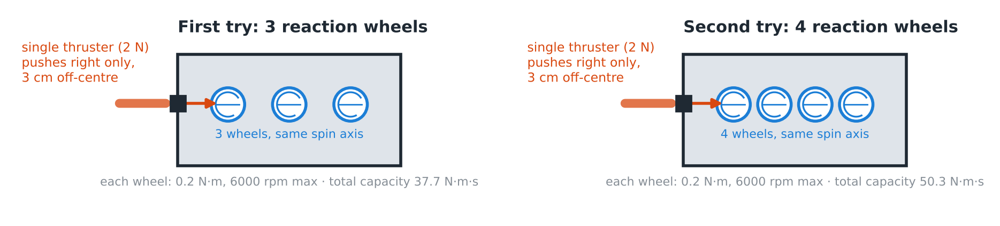
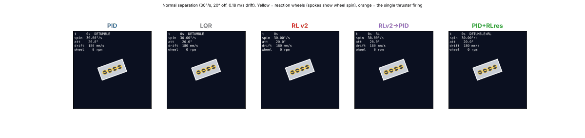

# PID vs LQR vs Reinforcement Learning

Comparing three controllers (classical PID, model-based LQR and a reinforcement learning agent) on three simulated 2D systems:

1. a self-balancing unicycle carrying a 5 kg mass
2. a satellite with four on/off thrusters recovering from a separation tumble
3. a satellite with reaction wheels and a single thruster (3-wheel and 4-wheel versions)

Everything is written from scratch in Python (numpy, scipy, matplotlib). The RL agents are small neural networks trained with Augmented Random Search (Mania et al., 2018).

The full write-up is in [`report/PID_vs_LQR_vs_RL_Report.pdf`](report/PID_vs_LQR_vs_RL_Report.pdf).

## Systems

| Unicycle | Four-thruster satellite | Reaction-wheel satellite |
|---|---|---|
|  |  |  |



## Results

| System | PID | LQR | RL | Notes |
|---|---|---|---|---|
| Unicycle (300 random runs) | 99.3 % | 100 % | 96.3 % | RL used the least effort but failed above 14 kg (trained on 3–8 kg) |
| Four-thruster satellite (120 runs) | 98 %, 46.9 s, 168 g | 100 %, 45.3 s, 135 g | 100 %, 41.3 s, 170 g | RL fastest, LQR most fuel-efficient |
| Reaction wheels, 3 wheels (100 runs) | 94 %, 113 s | 94 %, 117 s | 0 % | RL alone never finished the manoeuvre |
| Reaction wheels, 4 wheels (100 runs) | 100 %, 95.4 s | 100 %, 96.5 s | 48 %, 59.1 s | PID + small RL corrections: 100 %, 93.7 s |

Success rate, median time to recover and median fuel. Each folder's `results/results.txt` has the full numbers.

## Repo layout

```
unicycle/              wheeled inverted pendulum with a 5 kg mass
thruster_satellite/    2D satellite, one thruster per side
wheel_satellite_3/     3 reaction wheels + 1 thruster
wheel_satellite_4/     4 reaction wheels + 1 thruster, retrained RL and residual RL
report/                PDF report
media/                 setup diagrams and animations
```

Each system folder has:

- the model file: physics, PID, LQR and the RL policy (`unicycle_model.py`, `sat_model.py`, `wheel_model.py`, plus `controllers_v2.py` for the 4-wheel version)
- `train_rl.py` (`train_v2.py` for 4 wheels): trains the RL agent and saves it as `.npz`
- `evaluate.py`: runs every test and writes plots, an animation and `results.txt`
- `*.npz`: the trained agents, so you can evaluate without retraining
- `results/`: the outputs used in the report

## Running it

```
pip install -r requirements.txt
cd unicycle
python3 evaluate.py      # uses the saved agent
python3 train_rl.py      # retrain from scratch (optional)
```

For the 4-wheel satellite:

```
cd wheel_satellite_4
python3 train_v2.py rl --iters 600
python3 train_v2.py rl --resume --drift20 --iters 200
python3 train_v2.py residual --iters 200
python3 evaluate.py
```

Training takes from about 25 seconds (unicycle) to about 20 minutes (4-wheel RL) on a laptop CPU. `evaluate.py` writes its outputs into the folder it runs in.

`wheel_satellite_4/rl_residual_first_attempt.npz` and `rl_v2_stage1.npz` are earlier versions kept on purpose. The first residual agent learned to game the reward by spinning while firing the thruster (see section 9 of the report).

## Limitations

These are 2D models with simplified physics: no friction, fuel slosh or environmental torques. Training and testing use the same simulator, and each RL agent was trained once, with no seed-to-seed comparison. See section 10 of the report.
